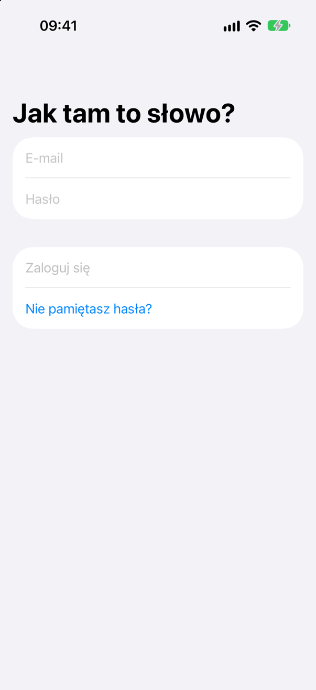
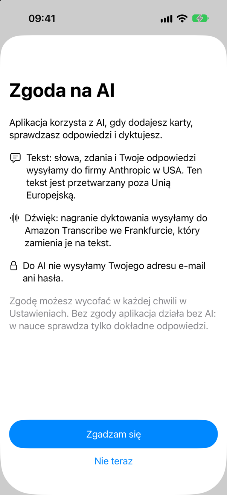
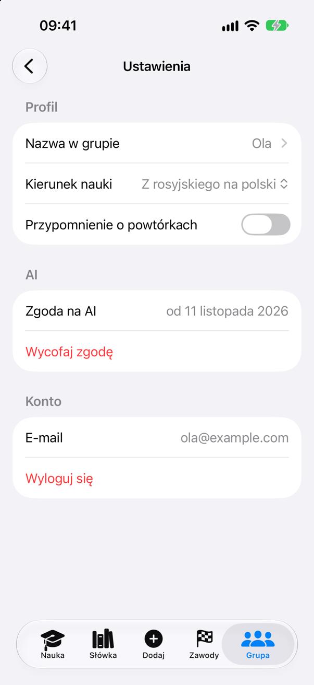
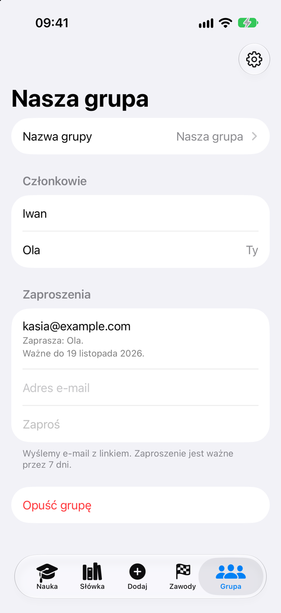
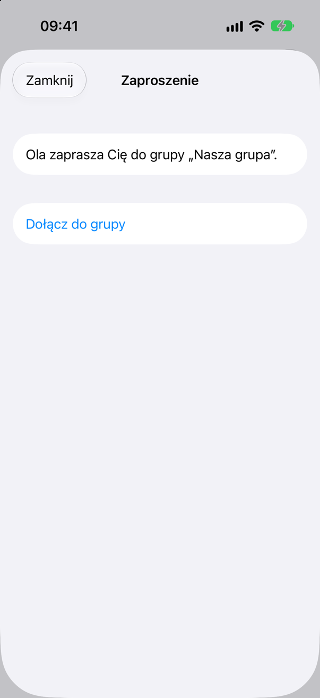
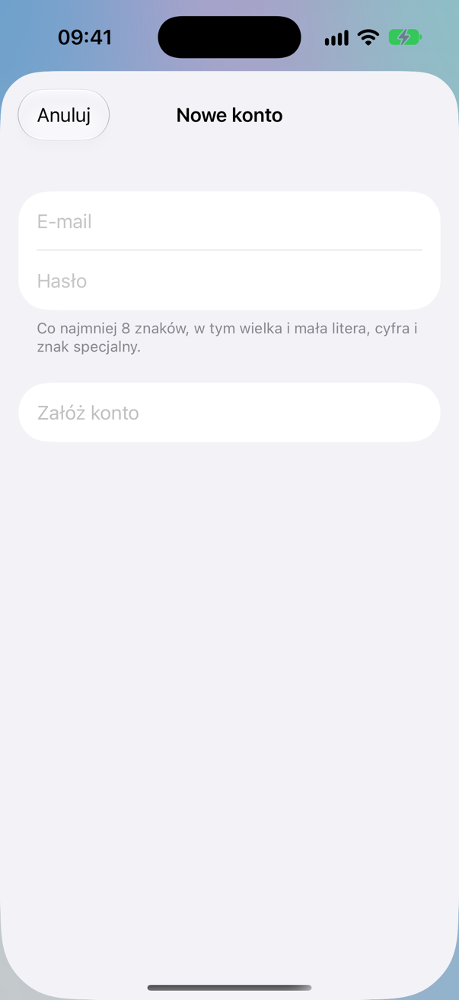

# Jak tam to słowo?

An iPhone app for Russian speakers who learn Polish: its words and its grammar. The members of a group share one collection of cards, study the cards in both directions and race each other. The interface is in Polish.

The app is in development. These screens exist today:

| Sign-in | AI consent | Settings |
|---|---|---|
|  |  |  |

| Group | Invitation | Sign-up |
|---|---|---|
|  |  |  |

## Parts

- `app/`: the SwiftUI app for iOS 26.
- `backend/`: the Go backend, an AWS Lambda function behind Amazon API Gateway, with Amazon Cognito for sign-in and Amazon Aurora DSQL for the data.
- `api/openapi.yaml`: the API contract. The Go types and the Swift client come from it.
- `infra/`: the AWS SAM and CloudFormation templates.
- [GLOSSARY.md](GLOSSARY.md): the terms of the project.

## Build and test

The app tests run in an iPhone simulator:

```bash
xcodebuild test -project app/Slowo.xcodeproj -scheme Slowo -destination 'platform=iOS Simulator,name=iPhone 17' -skipPackagePluginValidation
```

The backend tests need PostgreSQL 16, with its address in `TEST_DATABASE_URL`:

```bash
cd backend && go test ./...
```

## License

[MIT](LICENSE)
